# Local Goods

Local Goods lets employers in a Business Improvement District give staff credits that can only be spent at independent local shops, so office spending stays in the neighborhood.

**Try it:** https://uselocalgoods.com → **Try it yourself**

- **Real charging in Stripe test mode.** Employers pay a monthly platform fee for each participating employee with their credit purchase, and a district pays an annual program fee. Both are charged through Stripe in test mode, with no real money ([Business model](#business-model), [ADR 0042](docs/adr/0042-employer-platform-fee-switched-off.md), [ADR 0044](docs/adr/0044-bid-program-fee-charged-no-pilot-year.md)).
- **A hands-on sandbox.** Press Try it yourself for a private copy of the demo. Move money between the employer, employee, merchant and BID admin, and pay on Stripe's own card form ([walkthrough](JUDGES.md#try-it-yourself), [ADR 0045](docs/adr/0045-try-it-yourself-sandboxes.md)).
- **Two AI functions, with measured results.** Redemption Fraud Detection caught 17 of 26 suspicious redemptions on cases locked before the AI saw them, and Merchant Eligibility Matching only suggests: a person decides ([how the AI was measured](#how-the-ai-was-measured), [/eval](https://uselocalgoods.com/eval)).
- **A money safety case.** Employer money is held apart from Local Goods' own, and a check after every money step confirms the books cover every promise ([money safety case](docs/money-safety-case.md), [Where the money is](#where-the-money-is)).

**Video (2–3 min):** coming Nov 20.

## Local Goods in one minute

Local Goods turns a staff perk into business for the independent shops around
the office. Employers in Washington, DC's Golden Triangle district buy credits
for their staff, and those credits can only be spent at approved local cafés,
restaurants and shops in the district, never at chains. Employees get lunch or
coffee on the company, small businesses get new customers from the office
towers next door, and a district could see how much is being spent in its
neighborhood. Why trust it: the money an employer puts in is held for them and
their staff until it's spent, kept apart from Local Goods' own money, and a
check on every transaction confirms the books still cover what's been
promised. No one can spend more than they were given. An AI flags unusual
payments, and a person decides each one. It's a working prototype, running on
Stripe's test mode with no real money, built and tested in the open.

## Judges, start here

Scored on the official rubric. A five-minute path through the app is in [JUDGES.md](JUDGES.md). Everything below works until judging closes on November 30, 2026.

| Category (weight) | Strongest evidence |
|---|---|
| Functionality & technical execution (25%) | Buying, giving, spending, holding, paying out and refunding all work in Stripe test mode, and the books are re-checked after every money step: [Try it yourself](https://uselocalgoods.com), [`FraudGateTest`](tests/Feature/FraudGateTest.php), [money safety case](docs/money-safety-case.md). |
| Problem identification & relevance (20%) | A named buyer (employer HR), place (the Golden Triangle) and leak (office spending that goes home at 6 p.m.), with sourced numbers: [The problem, in numbers](#the-problem-in-numbers), [Why I built this](#why-i-built-this), [ADR 0002](docs/adr/0002-one-bid-and-one-employer-for-the-mvp.md). |
| AI integration & innovation (20%) | Two AI functions, each with a person deciding and results on locked cases; fraud detection fails closed and gates real transfers: [How the AI was measured](#how-the-ai-was-measured), [/eval](https://uselocalgoods.com/eval), [/eval/merchants](https://uselocalgoods.com/eval/merchants). |
| Code quality & GitHub transparency (15%) | Tests on two databases in [CI](.github/workflows/ci.yml), [decision records](docs/adr/), a locked eval set and a secret scan of the whole history: [TRANSPARENCY.md](TRANSPARENCY.md), [security verification](docs/security-verification.md). |
| UX & design (10%) | Phone-first screens, plain-English AI explanations and a tested design system: [Works on iPhone](#works-on-iphone), [DESIGN.md](DESIGN.md), [accessibility check](docs/accessibility.md). |
| Business impact & presentation (10%) | An employer-first pitch with a sourced, labelled projection: [Business model](#business-model), [/coming-next](https://uselocalgoods.com/coming-next), [Roadmap](#roadmap). |
| Bonus, up to +5: accessibility and ethical AI | Names never reach the AI, every AI decision is explained, a person approves each hold, and every page is tested for accessibility: [`AccessibilityTest`](tests/Feature/AccessibilityTest.php), [docs/accessibility.md](docs/accessibility.md), [Security & Trust](https://uselocalgoods.com/security). |

**How to look around.**

- **Try it yourself** (on [uselocalgoods.com](https://uselocalgoods.com)) gives you a private copy of the demo, with no account or password. Nothing you do there reaches the live demo.
- **Explore the live demo (read-only)**, the link under that button, signs you in to a read-only reviewer view with the guided tour, the AI evaluation, Where the Money Is and the Feedback button. Named reviewers get a personal link instead, so their feedback carries their name ([ADR 0010](docs/adr/0010-magic-links-for-reviewers.md)).
- **Security:** the plain-English [Security & Trust](https://uselocalgoods.com/security) page lists the protections and what isn't done yet; [security verification](docs/security-verification.md) shows how to check it yourself.
- [What is deployed right now](https://uselocalgoods.com/version): the commit this copy was built from and when.

## Why I built this

My passion for community improvement and public service all started in 2015, when I was only 10 years old. My father took me to volunteer at an organization he had a long-standing relationship with, called the Ministry of Caring. During the afternoon, I helped my dad cook soup and make sandwiches for a community initiative event, helping to raise awareness of growing homelessness in Wilmington, Delaware. It was an experience I would never forget. From then on, I have spent the last 11 years volunteering at the Kingswood Community Center, on several local political campaigns, and working in the United States Senate. Being a proactive member of my community has become a part of my identity. Now, instead of being boots-on-the-ground, I decided to take a step back and create an application that will have a real socio-economic impact on downtown communities and small businesses.

More than a decade ago, my father had a similar idea to Local Goods, which he called "InCity". InCity was based on a pre-paid gift card for employees to spend at local merchants within a Business Improvement District in Wilmington, DE. However, the idea was met with heavy resistance from employers, with many concerns stemming from tax implications to an overall negative sentiment towards the idea. After speaking to him about this contest, he sat me down and walked me through this story, which inspired me to build this platform. Now, I put my own spin on this idea using AI, creating a navigable platform that addresses this problem and a user interface that ties in all entities within a downtown district. I've talked to Mike Maggitti, the Executive Director of Downtown Visions, a BID located in downtown Wilmington, about this platform, where I walked him through the site and gathered feedback to spark interest in making this a long-term solution for an ever-growing problem. Regardless of any outcome, I want to continue working on this platform to create change for Business Improvement Districts around the world, to make a real economic impact on downtown areas, and to bring back pre-pandemic foot traffic levels for employees and downtown constituents.

## The problem, in numbers

Thousands of people work in the Golden Triangle, a business district in downtown Washington, DC, every weekday. Most follow the same loop: commute in, sit at a desk, commute out. That isn't a failing of the people doing it; it's how office work is set up. But it means their spending, and the life they could bring to the streets around them, goes home with them.

**Downtown Washington, DC.** Source for all three: [DowntownDC BID, *State of Downtown 2025*](https://www.downtowndc.org/wp-content/uploads/2026/05/260428_DDC_SoD_2025_Print.pdf) (published May 2026).

- **Office attendance is still under half.** "From March through December, office attendance was 48% of pre-pandemic activity, up from 44% during the same period in 2024, reaching a new monthly high of 51% of pre-pandemic office activity in July." (2025; page 20 of the PDF)
- **Overall foot traffic is recovering.** "A 2.5% increase in overall Downtown DC foot traffic in 2025 marked continued progress from prior years." (page 20)
- **Offices are still emptier than before.** Office vacancy "remains significantly above the pre-pandemic average of 11%." (page 24, CoStar data)

**Nationally.** Barrero, Bloom and Davis, in a 2021 working paper, project that working from home "will directly reduce spending in major city centers by at least 5-10 percent relative to the pre-pandemic situation." Their survey respondents "spent an average of $288 ($168) per week near their workplaces before COVID" in Manhattan (San Francisco), and they project a 13% drop in consumer spending in Manhattan. These are projections from 2021, not measurements ([NBER Working Paper 28731, April 2021 version](https://www.nber.org/system/files/working_papers/w28731/revisions/w28731.rev0.pdf); NBER's current page carries a later revision).

Employers already pay for perks. Local Goods turns that spending into foot traffic for independent merchants in the district.

## Feedback from a BID director

In November 2026 I walked Mike Maggitti, Executive Director of Downtown Visions (a BID in downtown Wilmington, DE), through Local Goods on a video call. His feedback gave us three roadmap ideas: residential property owners funding credits for their residents, a reusable wallet card, and delivery partners for Order to go (see the [Roadmap](#roadmap)).

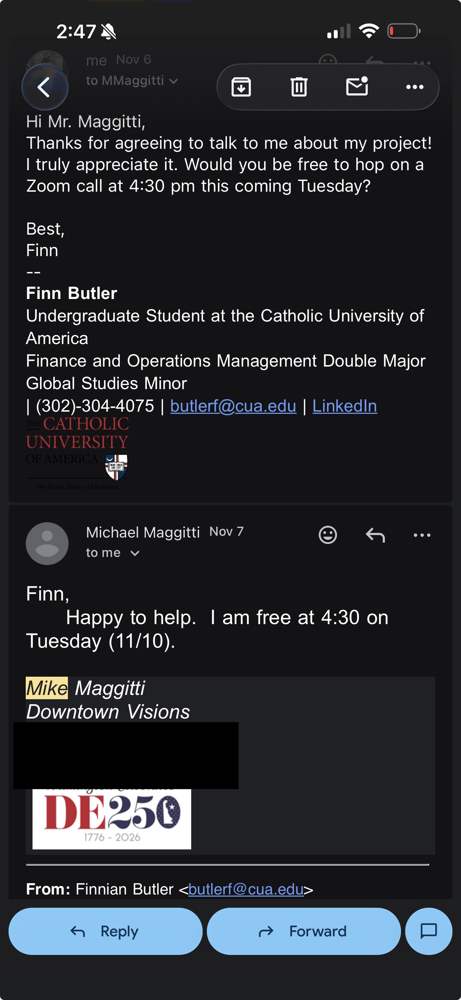

*Setting up the walkthrough, November 2026*

Shared with permission. This is feedback, not an endorsement or partnership.

## Screenshots

Taken from the live site and a phone. Every person and business is fictional, and no real money moves.

### Works on iPhone

<p align="center">
  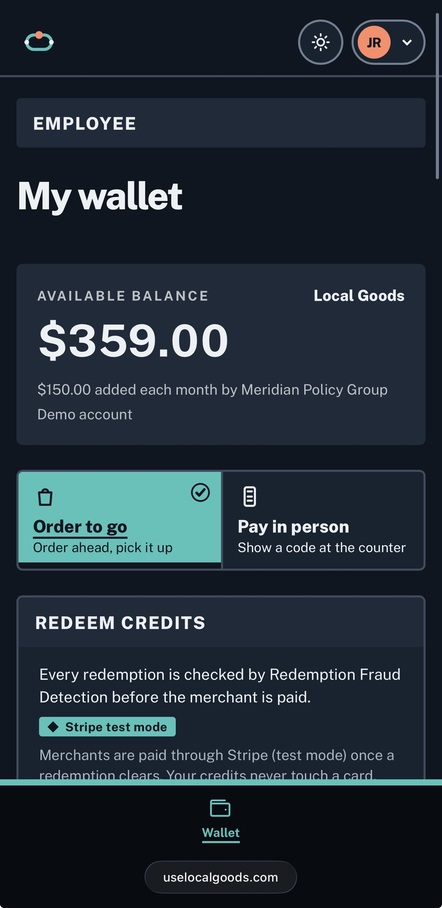
  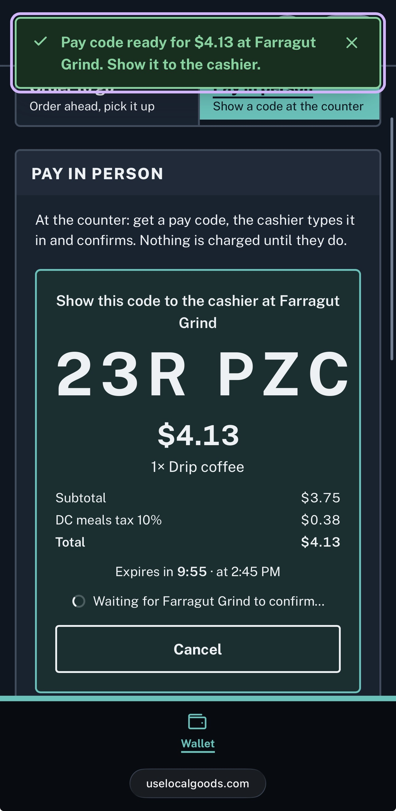
  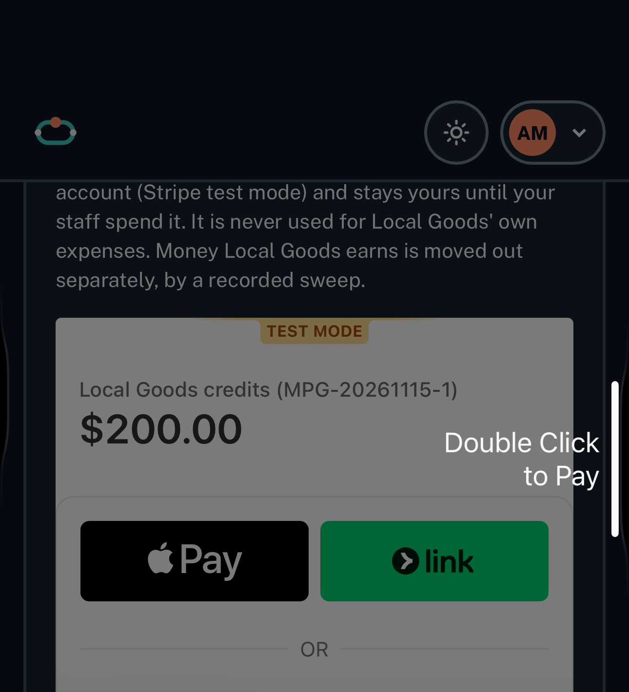
  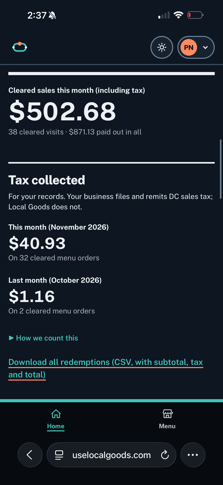
</p>

*The employee wallet, a pay code at the counter, Apple Pay at checkout (test mode) and the merchant's view.*

### On a computer

<table>
  <tr>
    <td width="50%">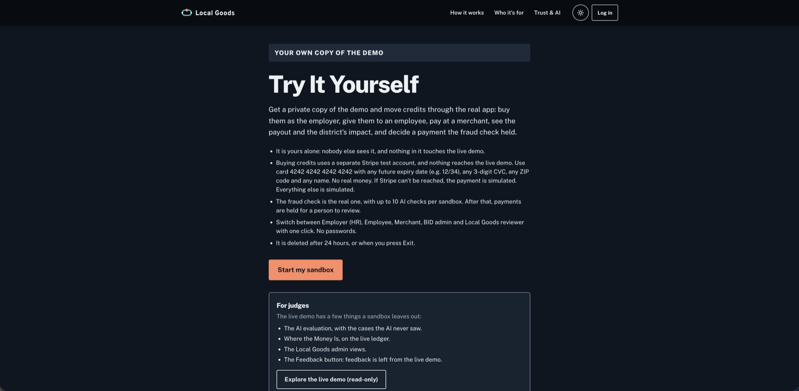<br><em>Try it yourself: a private copy of the demo for every visitor.</em></td>
    <td width="50%">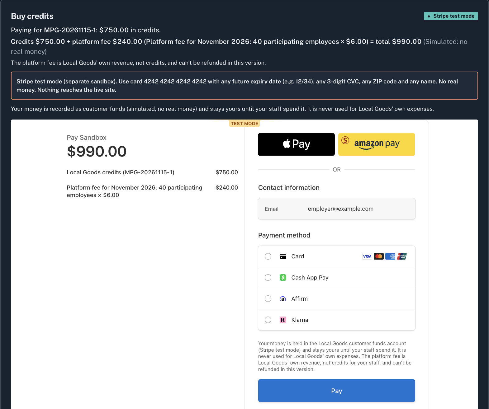<br><em>Buying credits in a sandbox on Stripe's own card form, from a separate Stripe test account.</em></td>
  </tr>
  <tr>
    <td width="50%">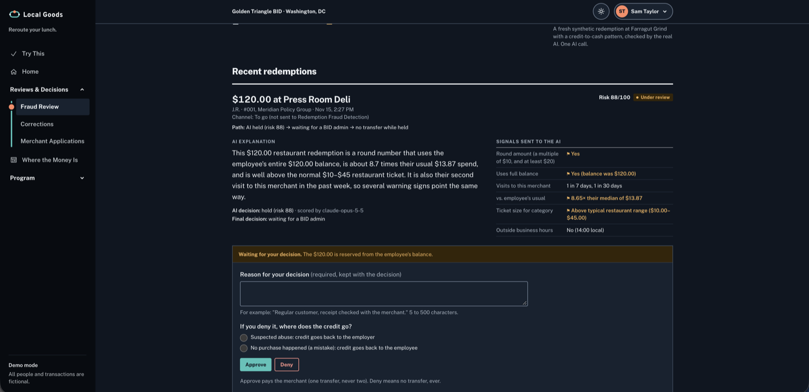<br><em>Fraud Review: a held payment waits for a person, who sees the signals and gives a reason.</em></td>
    <td width="50%">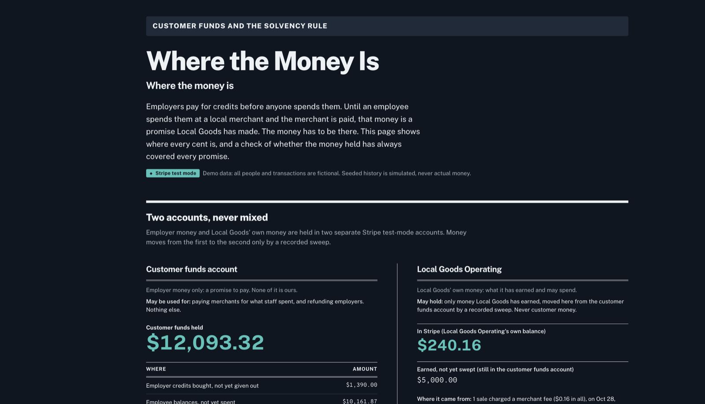<br><em>Where the Money Is: employer money and Local Goods' own money sit in two accounts.</em></td>
  </tr>
</table>

<details>
<summary>More screenshots</summary>

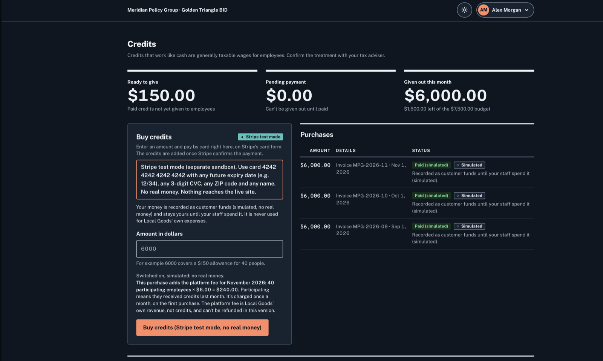

*The employer's Credits page in a sandbox.*

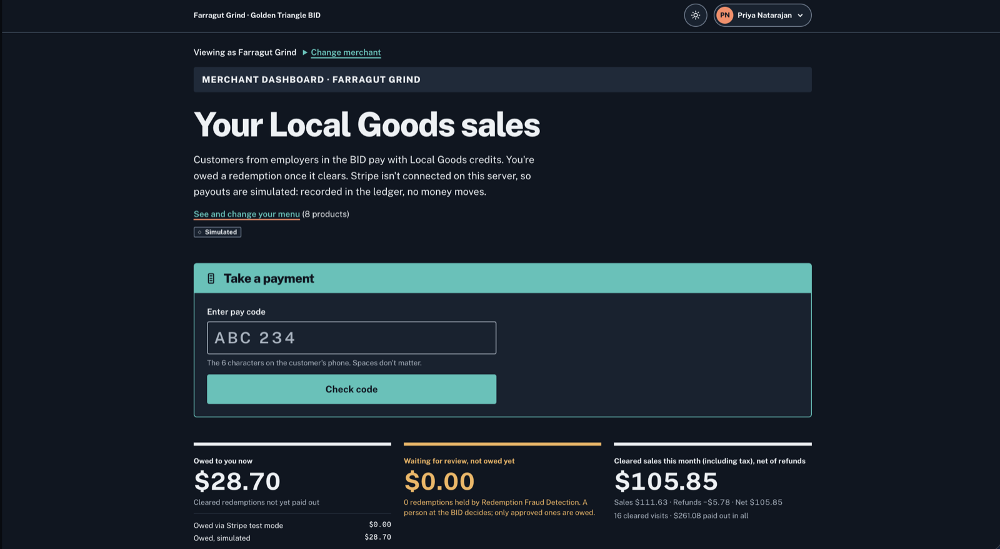

*The merchant dashboard in a sandbox.*

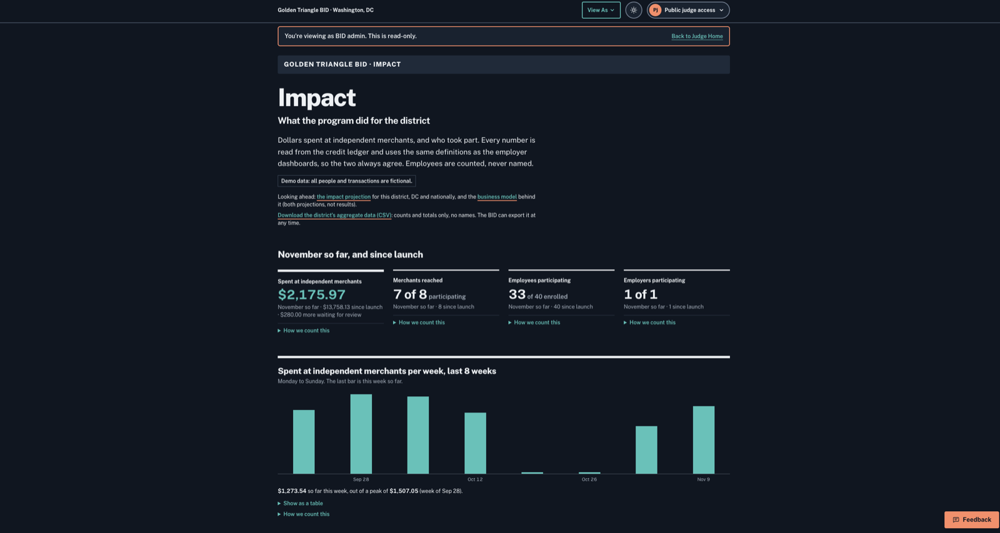

*BID impact: counts and totals only, never names.*

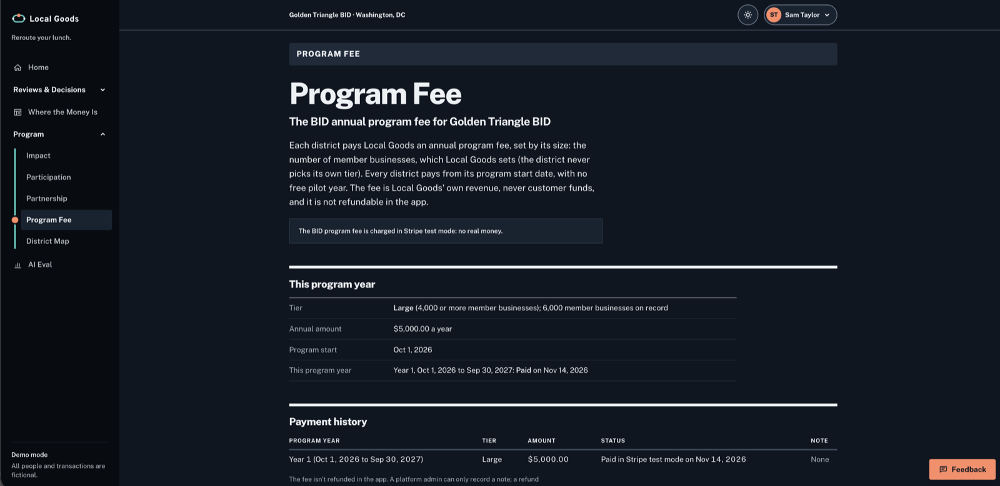

*The BID's annual Program Fee page, paid in Stripe test mode.*

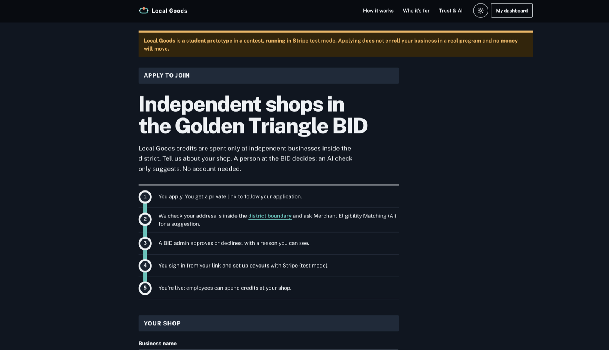

*A shop applies to join: a person at the BID decides, and the AI only suggests.*

</details>

## You work here. Spend here.

At 6 p.m., downtown's workers head home, and their spending goes with them.
Local Goods gives employees credits that only work at independent local
businesses, so the district your company calls home gets livelier.

> **Status:** working demo, running on Stripe's test mode with no real money. Employer, employee, merchant and BID dashboards cover the whole money loop in the ledger: buying credits, giving them out, spending, merchants owed and paid, and corrections. Redemption Fraud Detection scores every redemption, and held ones wait for a person to approve or deny with a reason, which gates every Stripe transfer. Shops apply at /apply, a BID admin approves them, and they set up Stripe payouts and go live. Payments and payouts run on **Stripe Connect in test mode** (Checkout for employer purchases, Express accounts for merchants, a Transfer per Stripe-funded cleared redemption); every money page says whether it's Stripe test mode or simulated. Seeded history stays simulated, and without Stripe keys the whole demo falls back to simulated mode. Both AI functions, Redemption Fraud Detection and Merchant Eligibility Matching, flag and explain. Redemption Fraud Detection clears redemptions it doesn't flag; people decide every held redemption and every new merchant.

**Live app:** https://uselocalgoods.com

[](https://github.com/finnbutler1/local-goods/actions/workflows/ci.yml)

**Stack:** Laravel 13 · PHP 8.4.1+ (CI on 8.4) · Tailwind CSS 4 (Vite 8) · SQLite (local) / Amazon RDS MySQL (production) · Claude API (`anthropic-ai/sdk`) · AWS Elastic Beanstalk · GitHub Actions · Stripe Connect, test mode (`stripe/stripe-php`)

## Why it matters

Everyone gains, and the district gains most.

- **The district.** More foot traffic and more spending at the independent
  shops, restaurants and services that give the Golden Triangle its
  character. A livelier district is good for everyone who works, lives or
  does business in it.
- **Employers.** A benefit staff actually use, because it shows up at lunch,
  not in a portal. And a practical way to improve the streets around their
  own office: a livelier neighborhood can make an office easier to recruit
  to, easier to stay at and more worth coming in to; a pilot would measure
  how much.
- **Merchants.** A large, steady workforce audience on their doorstep, and a
  reason for those customers to come back.
- **Employees.** A perk that makes the workday better (lunch, coffee,
  errands) and a reason to discover the neighborhood they already spend most
  of their week in.
- **The BID.** A measurable, privacy-respecting way to support the
  district's independent businesses: spending and participation are counted,
  employees are never named.

Money spent at independent local businesses tends to recirculate roughly 3x
more in the local economy than money spent at chains, an effect often called
the local multiplier. An estimate from an outside study, not measured by Local Goods: the Civic Economics / American Booksellers Association [Indie Impact study](https://www.publishersweekly.com/pw/by-topic/industry-news/bookselling/article/55547-news-from-aba-growing-shopping-local.html) found independent retailers and restaurants recirculated 52.3% of their revenue locally, against 15.8% for chains, about 3.3 times as much (data from 2011–2012, 134 businesses in 10 U.S. communities, none in DC). Real results here will be measured in a pilot.

## What's new since Nov 12

- **BID annual program fee, charged in Stripe test mode.** A district pays by its size (Small, Medium or Large, set by Local Goods from its member businesses), once per district per program year. There is no free pilot year: every district pays from its program start date. It is Local Goods' own money, kept apart from customer funds and never refunded in the app. The Golden Triangle's first program year was paid on 2026-11-14, with no real money ([ADR 0044](docs/adr/0044-bid-program-fee-charged-no-pilot-year.md); amounts are in [Business model](#business-model)).
- **Unspent credits are an estimate, never revenue.** The projection shows credits never spent next to revenue, but never counts them in revenue, profit or the break-even month. Credits don't expire, and Local Goods charges no dormancy fees ([ADR 0043](docs/adr/0043-bid-program-fee-and-unspent-credit-estimate.md)).
- **"Try it yourself" sandbox.** Each visitor gets a private copy of the demo, deleted after 24 hours or when they press Exit. A role bar switches between employer, employee, merchant, BID admin and Local Goods reviewer with no passwords, and the Merchant button opens the shop where the employee last paid. Buying credits uses Stripe's embedded card form on a separate Stripe test account, and falls back to simulated payments if Stripe can't be reached. A new shop can apply, be checked and approved, and go live at once inside the sandbox. AI checks and address lookups are capped per sandbox, and nothing a sandbox does reaches the live site or its Stripe account ([ADR 0045](docs/adr/0045-try-it-yourself-sandboxes.md), [walkthrough](JUDGES.md#try-it-yourself)).
- **Payroll report, Taxes and a note for banks.** On the employer dashboard, a payroll report downloads the credits given to each employee in a date range as a CSV. A plain-English Taxes section says credits are generally taxable wages and points to [IRS Publication 15-B](https://www.irs.gov/publications/p15b), and a folded note explains the Community Reinvestment Act for banks without saying Local Goods qualifies. An earlier version of this idea stalled because employers worried about taxes, so Local Goods gives employers a payroll report and a plain-English Taxes section. It is general information, not tax advice ([CHANGELOG](CHANGELOG.md)).
- **A Laravel security update.** On 2026-11-13, `laravel/framework` moved to 13.42.0 for advisory CVE-2026-128083 (low severity). The app doesn't use the affected Concurrency feature, so it was not exposed, and the update cleared the CI security audit ([SECURITY.md](SECURITY.md)).

## Business model

**How Local Goods makes money.** *Projection, not results*: every figure
below is worked out from stated assumptions, listed with sources in
[docs/finance/MODEL.md](docs/finance/MODEL.md), not measured.

- **Employers pay a monthly fee for each participating employee** (an employee
  who received credits the month before). It is added once a month to the
  employer's first credit purchase, on top of the credits: $6 in the base
  case, $4 to $10 in the range. The credits themselves all go to local
  merchants. In the product the fee is built and tested, and switched on in
  Stripe test mode on 2026-11-12 (no real money) on the live demo; switch it
  off by unsetting `EMPLOYER_PLATFORM_FEE_ENABLED`
  ([ADR 0042](docs/adr/0042-employer-platform-fee-switched-off.md)).
- **The fee is Local Goods' own operating money.** It is kept separate from
  customer funds on the ledger and moved to the separate Local Goods Operating
  account by an operating sweep
  ([ADR 0034](docs/adr/0034-two-separate-stripe-balances.md)). Customer money is never
  used for anything else.
- **Merchants pay nothing during the pilot.** A merchant fee is built and set
  to 0. Later, a small fee per sale (1.5% in the base-case projection) would
  come only once the program shows it brings merchants new sales: independent
  merchants run on thin margins and already pay card processing.
- **Districts would pay an annual program fee.** It is set by district size:
  Small (under 1,000 member businesses) $1,000 a year; Medium (1,000 to
  3,999) $2,500; Large (4,000 or more) $5,000. Every district pays from its
  program start date, with no free pilot year. The Golden Triangle, with
  nearly 6,000 businesses, is Large; the model has no size for other
  districts, so it uses Medium for each of them, paid from the month they
  launch. In the product a BID admin pays it in Stripe test mode (no real money),
  and the Golden Triangle's first program year was paid on 2026-11-14
  ([ADR 0044](docs/adr/0044-bid-program-fee-charged-no-pilot-year.md)). The business improvement
  district (BID) would receive a share of the employer fee (planned; no money
  goes to a BID today).
- **Unspent credits are never revenue.** In the product they don't expire:
  credits an employer hasn't given out yet can be refunded if the employer
  asks and a Local Goods admin approves it, and credits given to an employee stay in their wallet. The table below
  shows an estimate of credits never spent (about 8% of credits issued) next to
  revenue, but it is never counted in revenue, profit or the break-even month.
  Depending on state law, unspent balances may belong to the employer, the
  employee or the state (unclaimed property), so Local Goods doesn't rely on
  them. Local Goods charges no dormancy fees.
- **Taxes, for employers.** Credits given to employees are generally treated as
  taxable wages (cash equivalents aren't de minimis benefits that can be left
  out of wages:
  [IRS Publication 15-B](https://www.irs.gov/publications/p15b)), and buying
  credits is generally a business expense; the employer dashboard's **Payroll
  report** (a CSV of credits given to each employee in a date range) helps add
  them to payroll. Local Goods doesn't give tax advice; check with your payroll
  provider or tax advisor.
- **For banks: the Community Reinvestment Act.** Funding a Local Goods program
  in a qualifying low- or moderate-income area may support a bank's community
  development goals; buying credits for its own staff generally wouldn't on its
  own. The bank's regulator decides, and the rules are being revised
  ([Federal Register notice](https://www.federalregister.gov/documents/2026/08/12/2026-16454/community-reinvestment-act-regulations)).
  Check with your CRA officer.
- **One district alone does not break even in the base case.** The model breaks
  even DC-wide around month 54.

**Why this scales.** There are more than 1,000 Business Improvement Districts in the United States: the Rutgers and International Downtown Association census counted 1,001 in 2010 ([IDA](https://downtown.org/knowledge-center/2011-u-s-bid-census-report)). The IDA also counts "4,000+ place management organizations globally", often called BIDs ([IDA](https://downtown.org/about-the-industry/); a broader count that is not dated). One district's results sell the next: a BID that can show spending reaching its own independent shops has something to show its neighbours. A new district needs setup, not new code: a boundary and its merchants ([ADR 0031](docs/adr/0031-districts-partnerships-merchant-joining.md)). The DC-wide and national rows in the table above show what that adds up to. Employers and BIDs pay, and merchants don't, because independent merchants run on thin margins: "In 2019, pre-tax income represented approximately 5% of sales for a typical restaurant" ([National Restaurant Association, 2022](https://restaurant.org/research-and-media/research/economists-notebook/analysis-commentary/bottom-line-impact-of-rising-costs-for-restaurants/)).

The model is worked out month by month from stated assumptions, each with a
public source or labelled an assumption to check in customer discovery. On the
assumptions as of October 2026, the Golden Triangle alone is a pilot rather
than a business; the model depends on growing to more districts and on the
employer fee. Method, every assumption and what we still have to learn:
[docs/finance/MODEL.md](docs/finance/MODEL.md). Signed-in reviewers can explore
low and high cases on the Business model page.

<!-- projection:readme-table:start -->
| Base case | Year 1 | Year 2 | Year 3 | Year 4 |
|---|---|---|---|---|
| Golden Triangle only: revenue | $31k | $79k | $101k | $101k |
| Golden Triangle only: unspent credits (estimate, not counted as revenue) | $16k | $44k | $58k | $58k |
| Golden Triangle only: EBITDA | −$196k | −$124k | −$92k | −$92k |
| DC-wide: revenue | $31k | $147k | $417k | $772k |
| DC-wide: unspent credits (estimate, not counted as revenue) | $16k | $81k | $238k | $448k |
| DC-wide: EBITDA | −$216k | −$308k | −$395k | −$148k |
| National rollout: revenue | $54k | $442k | $1.85M | $4.63M |
| National rollout: unspent credits (estimate, not counted as revenue) | $28k | $243k | $1.05M | $2.67M |
| National rollout: EBITDA | −$317k | −$820k | −$1.27M | −$935k |
<!-- projection:readme-table:end -->

## How it works

1. **The employer buys credits** for its employees through its local BID (the
   MVP uses the Golden Triangle BID in Washington, DC). *Today: the employer
   dashboard records a purchase as pending; HR pays through Stripe Checkout
   in test mode (test card 4000 0000 0000 0077), and only when Stripe's
   signed webhook confirms it can HR give the credits to employees, one at a
   time or in bulk. Stripe holds the money, not Local Goods
   ([docs/STRIPE.md](docs/STRIPE.md)).*
2. **Employees redeem them at merchants inside the BID**, using their phone as
   the card, two ways: **Order to go** (redeem in the app and show the
   confirmation) or **Pay in person** (get a one-time 6-character pay code
   that the cashier types into the merchant dashboard and confirms; nothing
   moves until they do, [ADR 0026](docs/adr/0026-pay-in-person-with-pay-codes.md)).
   Ordering from a menu shows the DC sales tax before paying (subtotal, tax,
   total), and the merchant sees the tax it collected for its own records;
   it's a display at DC's published rates, not tax advice
   ([ADR 0027](docs/adr/0027-dc-sales-tax-shown-at-redemption.md)). *Today: employees can only redeem at approved, live merchants
   inside the district: the demo's fictional merchants, plus any shop that
   joins through Apply to join (step 6). Merchant Eligibility Matching also
   assesses real businesses in the BID for the BID admin to review.*
3. **AI checks every redemption.** *Live: suspicious redemptions are held and
   shown on the BID admin view, where a person approves or denies them, with a reason.
   Merchants are owed a redemption only once it clears; a cleared redemption
   funded by Stripe-paid credits becomes a Stripe test-mode transfer to the
   merchant's connected account. Held or denied ones never transfer: one gate,
   `TransferGate`, decides every transfer ([ADR 0016](docs/adr/0016-fraud-detection-gates-stripe-transfers.md)).*
4. **Mistakes get fixed, on the record.** Employees, merchants and HR can ask
   for a correction; the platform admin approves or rejects it with a reason
   they see. A refund reverses that part of the merchant's Stripe transfer,
   unspent credits go back to the employer's card as Stripe refunds, and a
   missed payout is sent again, each as a new append-only ledger line
   confirmed by Stripe's webhook, and reconciliation still matches
   ([ADR 0028](docs/adr/0028-refunds-and-corrections.md)).
5. **How Local Goods would earn money.** The main revenue line is the
   employer platform fee: a monthly fee for each participating employee,
   added once a month to the employer's first credit purchase on top of the
   credits, never refundable, and kept apart from customer funds
   ([ADR 0042](docs/adr/0042-employer-platform-fee-switched-off.md)). A
   per-transaction merchant fee is a second, smaller setting that charges
   nothing by default. When it is set, each sale keeps the fee it was made
   with, the merchant's Stripe transfer is the sale less the fee, a refund
   gives back its share of the fee, and reconciliation checks it all. Only
   the platform admin can change it, and every change is logged
   ([ADR 0029](docs/adr/0029-merchant-fee-ready-but-at-zero.md)). The BID
   annual program fee is built too: a BID admin pays one program year at a time
   through Stripe Checkout in test mode, at the price of the district's size
   tier (set by Local Goods, never by the browser), once per district per
   year; it is Local Goods' own money, swept and reconciled like the other
   fees, and never refunded in the app
   ([ADR 0044](docs/adr/0044-bid-program-fee-charged-no-pilot-year.md)).
6. **Shops join, and the district boundary is enforced.** An independent
   shop applies at [/apply](https://uselocalgoods.com/apply)
   (no account) and follows a private status link. Local Goods checks the
   address against the BID boundary DC publishes and asks Merchant
   Eligibility Matching for a suggestion; a BID admin approves or declines
   with a reason. The shop then sets up Stripe payouts and goes live.
   Credits can only be spent at approved, live merchants inside the
   district, and a district can have only one active exclusive BID
   partnership. See the [district map](https://uselocalgoods.com/district)
   and [who does what](https://uselocalgoods.com/who-does-what)
   ([ADR 0031](docs/adr/0031-districts-partnerships-merchant-joining.md)).

**Live activity, not backdated.** From late October to judging, a scheduled
generator makes a small slice of activity each weekday, busiest at lunch,
through exactly the same steps a person's actions go through: the real fraud
check on every payment, Stripe test-mode payments and transfers, and the
occasional refund request. It never decides anything: held payments and
refund requests wait for a person. Everything it made is marked **Demo
activity**, its people and merchants are fictional, and it runs only in
Stripe test mode. See what it has done on the BID admin's Demo activity page
([ADR 0032](docs/adr/0032-live-demo-activity-in-stripe-test-mode.md)).

**Try it:** press **Try it yourself** on [uselocalgoods.com](https://uselocalgoods.com) for a private copy of the demo with no account. As the employer, buy credits (Stripe's test card 4242 4242 4242 4242, any future date, any CVC) and give them to an employee. As the employee, redeem a normal amount, or get a pay code under **Pay in person** and take it to the merchant's **Take a payment**. To see tax at checkout, order from a menu in the wallet. Press **Try a suspicious redemption** under **Demo Tools**, then, as the BID admin, approve or deny the held payment, and press **Run a collusion example** to watch the real AI check a synthetic credit-to-cash redemption. Open **Corrections** to see how a refund or a missed payout is fixed, and **Merchant Applications** to see a new shop join. The [AI eval results](https://uselocalgoods.com/eval) are public. Reviewers can also use the read-only live demo, with a guided tour, a "view as" switcher for each role and a Feedback button on every page ([ADR 0010](docs/adr/0010-magic-links-for-reviewers.md)). The shared demo logins are available on request; there is no public sign-up.

## The two AI functions

| Function | Status | What it does |
|---|---|---|
| **Redemption Fraud Detection** | **Live** | Scores every redemption 0–100 for abuse such as credit-to-cash collusion. It returns `clear` or `hold` with a plain-English explanation. Only anonymous signals are sent (amount, balance, visit counts, category, hour), never names. |
| **Merchant Eligibility Matching** | **Built (triage)** | *The AI is a triage tool: it screens out obvious chains and franchises, routes anything it can't verify to a person, and never approves a merchant on its own.* Suggests whether a real business in the BID is independent (not a franchise, not chain- or PE-owned, five or fewer locations), with a classification, written reasoning and a 0–1 confidence. It sees only the business's public license facts and has no web access. A BID admin approves, rejects or asks for research. A failed or invalid answer becomes "undetermined" for a person, never a guess. Every business is labeled "Candidate — not a Local Goods participant." An AI "eligible" is shown as "AI recommends eligible — confirm before approving" and is never approved automatically. Measured against 60 hand labels at [`/eval/merchants`](https://uselocalgoods.com/eval/merchants) ([ADR 0013](docs/adr/0013-merchant-eligibility-matching.md)). |

**Data:** the merchant candidates come from public DC business license records. Only business information is kept (name, address, category, license type): no owner names, contact details or personal data. The AI's outputs are tested so they never name individuals ([details](TRANSPARENCY.md#merchant-data-public-business-information-only)).

## How the AI was measured

Each result is on cases held back from prompt writing, with a 95% Wilson confidence interval (`php scripts/eval-intervals.php` prints them). With samples this small the intervals are wide.

| Measure | Result | 95% interval |
|---|---|---|
| Fraud: suspicious cases caught | 17 of 26 | 46.2–80.6% |
| Fraud: holds that were suspicious | 17 of 19 | 68.6–97.1% |
| Fraud: agreement with the person | 39 of 50 | 64.8–87.2% |
| Merchant: agreement with the hand labels | 17 of 20 | 64.0–94.8% |
| Merchant: always-"not eligible" baseline | 17 of 20 | 64.0–94.8% |
| Merchant: independents found | 0 of 3 | 0–56.1% |
| Merchant: chains wrongly called eligible | 0 of 17 | 0–18.4% |

**Against the baseline.** Merchant Eligibility Matching agrees with the labels on 17 of 20, which is exactly what answering "not eligible" every time would score. On agreement it shows no gain over that baseline, and it found none of the 3 independents (with 3 cases, that tells us little). What it did do is call none of the 17 chains eligible and send 14 of 20 cases to a person, which is the job of a triage tool. For fraud there is no such simple baseline: a rule of "always clear" would catch 0 of 26.

**Locked before testing.**
- Fraud: the 50 `holdout_3` cases were labeled by hand in commit `5f594c1` and locked with a SHA-256 per row before the AI saw them. The prompt is frozen at `8d5e1e70`, and CI fails if a locked row changes.
- Merchant: the 60 hand labels are locked in `data/merchant_labels_lock.json` (labeling commit `37cc902`). The prompt is frozen at `458e8c2d` and the holdout was run once with it.

**Known limits.**
- The planted collusion rings look ordinary one redemption at a time, so the fraud check does not catch them; that would need new signals and a fresh holdout.
- The merchant AI has no web search, so it routes most independents to a person.
- The fraud cases are synthetic, and one person made all the labels. Agreement shows how closely the AI matches that person, not whether either is right about real fraud.
- A blind review of the disagreements got no votes ([TRANSPARENCY.md](TRANSPARENCY.md#checking-the-persons-labels-blind-adjudication-retired)).

Details: [fraud results](docs/evals/fraud-eval-results.md), [merchant results](docs/evals/merchant-eval-results.md), [method](TRANSPARENCY.md#how-we-measure-it).

## Fails closed

When the AI call fails, Local Goods holds the redemption instead of approving it. It fails closed, the way a bank's fraud team would design it.

The following all produce a hold with risk score 100:

- an API error, timeout or missing key
- a refusal
- malformed JSON
- an out-of-range score

If Claude says `clear` but gives a score of 70 or higher, the app holds it
anyway. A held redemption keeps the employee's credits reserved and appears on
the BID admin view, where a person approves it (the reserved credits are spent)
or denies it (suspected abuse: the credits go back to the employer; no purchase
happened: back to the employee). Each decision needs a reason and is recorded with
who decided, when and what the AI said, and a redemption can only be
decided once. A held redemption never reaches Stripe; only a cleared one funded by Stripe-paid credits is transferred (test mode). See
[`RedemptionFraudDetector.php`](app/Services/Fraud/RedemptionFraudDetector.php),
its [tests](tests/Feature/RedemptionFraudDetectorTest.php) and
[ADR 0003](docs/adr/0003-fail-closed-fraud-detection.md).

## Where the money is

Employers pay for credits before anyone spends them, so most of the money Local Goods holds is a promise, not ours. Every line in the ledger is in one of two places, never both: **customer funds held** (employer credits not yet given out, employee balances, money owed to merchants, and anything held waiting for a person) or **operating funds** (only what Local Goods has earned: the employer platform fee and the BID program fee, both charged in Stripe test mode, and a few cents from a three-minute test of the merchant fee setting). **Unspent credits are customer funds held for the program, never Local Goods' money.** Credits an employer hasn't given out yet stay on its balance and can be refunded if the employer asks and a Local Goods admin approves it; credits given to an employee stay in their wallet, with no expiry.

**Two separate Stripe accounts.** Employer money is held in the **customer funds account** (the Stripe platform balance), which may only pay merchants and refund employers. Local Goods' own money is held in a separate Stripe test-mode account, **Local Goods Operating**. Money gets there only by a recorded **sweep**: decided by the platform admin with a reason, never edited, and refused by the solvency guard if it would leave customer funds short. Reconciliation checks both balances against Stripe, and the employer's Buy credits screen, Stripe Checkout and every merchant payout say which account the money is in ([ADR 0034](docs/adr/0034-two-separate-stripe-balances.md)).

The rule: the money paid in, less what has been paid out to merchants and refunded to employers, must always cover every open promise, with each account counted on its own so one below zero never hides another. Simulated money never pays for a Stripe test-mode transfer.

- **Checked over the whole history.** [`ledger:check-solvency`](app/Console/Commands/CheckSolvency.php) replays every ledger entry in order and checks the rule after each one, so a past moment that went wrong can't be hidden by a later correction. It runs after every deploy and on every tick of the demo activity generator, which stops the day if it fails.
- **Enforced.** Every money operation Local Goods decides is checked at its end, and every Stripe transfer before it is sent; anything that would leave less money than has been promised is refused and nothing changes ([`SolvencyGuard`](app/Services/Solvency/SolvencyGuard.php)).
- **Found two real gaps first.** A refund on a simulated sale that was already paid out left the merchant below zero, and on some seed dates the planted collusion ring overdrew its credits. Both were fixed before the rule was enforced.
- **What it doesn't cover:** holding the money the way a real deployment would need. Two separate Stripe test-mode balances are a real separation of balances, but the customer funds account is not a bank FBO ("for benefit of") or trust account, and both accounts are controlled by Local Goods through Stripe. A real deployment would hold customer funds at a bank or a regulated payments partner, and money-transmission rules may apply; what exactly is required needs legal advice, which we have not had. It also doesn't cover Stripe's own balance (that is reconciliation), Stripe's card fees (in test mode Stripe takes them from the customer funds balance), and money still in flight between Stripe and its webhook. Simulated money is not real money.

See it on [Where the money is](https://uselocalgoods.com/where-the-money-is) (signed-in reviewers) and in [ADR 0033](docs/adr/0033-customer-funds-and-the-solvency-rule.md) and [ADR 0034](docs/adr/0034-two-separate-stripe-balances.md).

## Safety and privacy from the start

These were built in from the first version of each feature, not added afterwards. Each line links to where it lives.

- **An append-only ledger in whole cents.** Every credit and payout is a ledger entry that is never edited, and money is stored as integer cents, so there are no rounding drifts ([ADR 0012](docs/adr/0012-one-ledger-three-account-kinds.md), [`CreditLedgerEntry`](app/Models/CreditLedgerEntry.php)).
- **A cap on the loss from a missed fraud, and a test for it.** The most one missed fraud can move is the credits loaded onto one employee ([`MissedFraudLossCapTest`](tests/Feature/MissedFraudLossCapTest.php), [why](#which-error-we-chose-to-minimize)).
- **The fraud gate and human review.** A held payment never reaches Stripe; a person approves or denies it, with a reason that is recorded ([ADR 0016](docs/adr/0016-fraud-detection-gates-stripe-transfers.md), [`FraudGateTest`](tests/Feature/FraudGateTest.php)).
- **A privacy audit, and a name check with its limits.** Merchant data is public business information only, and a test scans every committed AI output for named individuals. [TRANSPARENCY.md](TRANSPARENCY.md#how-does-the-test-recognize-a-named-individual) says what that check can miss ([`MerchantOutputPrivacyTest`](tests/Feature/MerchantOutputPrivacyTest.php), [`EmployeeNamePrivacyTest`](tests/Feature/EmployeeNamePrivacyTest.php)).
- **An origin lock.** The app answers only requests that came through CloudFront ([ADR 0018](docs/adr/0018-only-cloudfront-reaches-beanstalk.md)).
- **Rate limits.** Every write route has its own limit, and a test fails if one that can reach Claude has none ([`RateLimitsTest`](tests/Feature/RateLimitsTest.php), [TRANSPARENCY.md](TRANSPARENCY.md#security)).
- **Pay codes stored hashed and never logged.** Never in a URL, never shown back after a mistake ([ADR 0026](docs/adr/0026-pay-in-person-with-pay-codes.md), [`PayCodes`](app/Services/PayCodes.php), [`PayCodeTest`](tests/Feature/PayCodeTest.php)).
- **Idempotent webhooks.** Stripe events are verified by signature and each one is applied once ([`StripeWebhookHandler`](app/Services/Payments/StripeWebhookHandler.php), [docs/STRIPE.md](docs/STRIPE.md)).
- **An over-refund guard.** Each refund is re-checked against what was paid, what was already refunded and the tax, before any money moves ([ADR 0028](docs/adr/0028-refunds-and-corrections.md), [`CorrectionLimits`](app/Services/Corrections/CorrectionLimits.php)).
- **A locked eval set.** The held-out cases are fixed by a SHA-256 per row before the AI sees them, and CI fails if one changes ([`fraud_eval_lock.json`](data/fraud_eval_lock.json), [TRANSPARENCY.md](TRANSPARENCY.md#how-we-measure-it)).
- **CI on two databases.** Every push runs the suite (about 1,800 tests; the few that need MySQL are skipped on a plain local run) on both SQLite and MySQL ([`ci.yml`](.github/workflows/ci.yml)).

## Which error we chose to minimize

Which error we chose to minimize, and why. Local Goods is tuned to avoid false holds, even though that lets some fraud through. On our locked held-out test it caught 17 of the 26 suspicious redemptions, and 17 of the 19 redemptions it held were truly suspicious. We accept that trade on purpose. A false hold falls on the person least able to absorb it: a salon owner or café waiting on money she has already earned, and a merchant who gets stuck once may quietly stop accepting the credits. That would empty the program from the inside. A missed fraud, by contrast, is capped: an employee can never spend more than the credits their employer has put in their wallet, their balance never goes below zero, and a merchant is paid only for credits an employee actually spent. So the most one missed fraud can move is the credits loaded onto that one employee ([how we test this](tests/Feature/MissedFraudLossCapTest.php)). It is paid by the employer, not the merchant, and repeat patterns get easier to spot over time. So we would rather miss a small, bounded loss than delay an honest merchant’s pay. If fraud turns out to be costlier than we expect, the threshold can be tightened, and we will measure any change on a fresh held-out set, never on the cases we have already seen.

## Designed for the people in the transaction

Choices we made for the people involved, each with the reason and where it lives.

- **Merchants see employee initials, never names.** A shop needs to know a payment is real, not who the person is. Outside their own wallet, employees appear as initials ([ADR 0014](docs/adr/0014-employer-program-pending-purchases-and-initials.md), checked on every page by [`EmployeeNamePrivacyTest`](tests/Feature/EmployeeNamePrivacyTest.php)).
- **A held payment uses neutral words.** A held in-person payment happens with the customer at the counter, and the AI's check can be wrong, so both screens say it is held in neutral words, with no fraud words, and nobody is accused ([ADR 0026](docs/adr/0026-pay-in-person-with-pay-codes.md), [TRANSPARENCY.md](TRANSPARENCY.md#paying-in-person-what-the-ai-does-and-doesnt-see)).
- **Refunds and corrections exist.** Before them, nothing could fix a money mistake once a payment had cleared: a wrong amount, a transfer that never arrived. Now there is a request, a person's decision with a written reason, and a real Stripe action behind it ([ADR 0028](docs/adr/0028-refunds-and-corrections.md)). Why we also tune the fraud check to avoid false holds, which fall on a shop waiting on money it has already earned, is in [Which error we chose to minimize](#which-error-we-chose-to-minimize).
- **The AI flags; a person decides every held payment and every new merchant.** A held payment waits for a BID or platform admin, and the merchant AI only recommends ([ADR 0016](docs/adr/0016-fraud-detection-gates-stripe-transfers.md), [ADR 0013](docs/adr/0013-merchant-eligibility-matching.md)).
- **The text font is Atkinson Hyperlegible Next.** It was designed for readability by people with low vision. (The decision record names the font, not our reason, so that is a fact about the font, not a study of ours.) Every text and background pair is tested for contrast in light and dark ([ADR 0025](docs/adr/0025-transit-lines-brand.md), [`ColorContrastTest`](tests/Unit/ColorContrastTest.php)).
- **Every page works at phone width.** Tables become cards, tap targets are 44px, and fields are at least 16px ([docs/accessibility.md](docs/accessibility.md), [`ResponsiveTablesTest`](tests/Feature/ResponsiveTablesTest.php)).
- **Honesty labels are never hidden on small screens.** "Demo data", "Stripe test mode", "Not affiliated with the Golden Triangle BID" and the prototype notice stay visible on a phone ([`PhoneHonestyTest`](tests/Feature/PhoneHonestyTest.php)).

## What we chose not to build, and why

Saying no was part of the design. Each decision below is already in our decision records, with the reason. The same table is on the public [Who does what](https://uselocalgoods.com/who-does-what#not-built) page.

| Decision | Reason |
|---|---|
| The merchant fee ships switched off. Nothing is charged, and a test stops any seed from turning it on ([ADR 0029](docs/adr/0029-merchant-fee-ready-but-at-zero.md)). | We haven't talked to merchants about pricing yet, so it stays off until customer discovery tells us what is fair. |
| A payout that was reversed in the Stripe dashboard is not re-sent by us. It is refused, and a person sorts it out in Stripe ([ADR 0028](docs/adr/0028-refunds-and-corrections.md)). | A second automatic money path on top of a reversal Stripe itself made is easy to get wrong, and we won't add one before judging. |
| Unspent credits are never counted as revenue ([ADR 0030](docs/adr/0030-business-model-projections.md)). | They are customer funds held for the program: credits not yet given out stay on the employer's balance and can be refunded if the employer asks and a Local Goods admin approves it, and credits given to an employee stay in their wallet with no expiry. A test checks that revenue doesn't move with the share spent. |
| No issued card, so no interchange ([ADR 0029](docs/adr/0029-merchant-fee-ready-but-at-zero.md), [model](docs/finance/MODEL.md)). | The MVP has no card program, and we could not verify the interchange rate, so the model keeps it off. |
| No admin "Cancel" button on a held in-person payment ([ADR 0026](docs/adr/0026-pay-in-person-with-pay-codes.md)). | The shop is the one who knows the customer paid another way, so only the shop can cancel. An admin's Deny already returns the credits. |
| No card preview: a Stripe Issuing test card next to pay codes ([ADR 0036](docs/adr/0036-no-card-preview-yet.md)). | Issuing switches on instantly in test mode, but funding cards needs a business account behind an identity check, which we chose not to complete with invented details. We won't show a fake card instead. |
| Merchants can't sell gift cards, gift certificates or other cash-like items for credits ([ADR 0023](docs/adr/0023-product-menus-are-display-only.md)). | Buying one with credits would turn credits into cash that could be spent anywhere, which breaks the rule that credits are only spent at local independent shops. The planned employer-funded prepaid card enforces the same principle from the other side, by refusing everywhere except approved shops. |
| No email sending in the prototype ([ADR 0007](docs/adr/0007-fortify-for-login-and-a-role-column.md), [ADR 0031](docs/adr/0031-districts-partnerships-merchant-joining.md)). | There is no mail service, so we don't promise a reset link that would never arrive. An applicant's private status link is shown once instead. |
| The Merchant Eligibility Matching AI has no web search ([ADR 0013](docs/adr/0013-merchant-eligibility-matching.md)). | Adding it means a new prompt version and a fresh unseen test set. Until then it says "undetermined" and a person decides. |
| We don't reset the live demo for convenience ([CLAUDE.md](CLAUDE.md)). | Reset demo would erase real examples judges can see on the live site, such as the in-person payment, taxed orders and a completed correction, so it is for local use only. |
| Nothing in the app refunds the BID program fee. A platform admin can only record a note ([ADR 0044](docs/adr/0044-bid-program-fee-charged-no-pilot-year.md)). | The fee is Local Goods' own money, kept apart from customer funds, and a refund of it would be one more money path. Any refund is decided outside the app. |
| No business-model figures on public pages, and the local-spending estimate only with its outside-study label and source ([ADR 0024](docs/adr/README.md), [`PublicClaimsTest`](tests/Feature/PublicClaimsTest.php)). | The figures are a projection, not results, and the estimate comes from an outside study that Local Goods has not measured. |
| A fee charged during a three-minute check that the fee setting worked is kept as earned income, not given back ([ADR 0034](docs/adr/0034-two-separate-stripe-balances.md)). | On Oct 28, from 12:08 to 12:11 (fee audit log), the merchant fee was switched on live to check that it worked, and one sale was charged a few cents. We considered building a way to give it back, and decided that a new money path for so small an amount, this close to the freeze, was the wrong trade. Instead we recorded exactly what happened and treated it as earned. Otherwise Local Goods charges nothing. |
| Customer money is never used for anything else: not invested, not lent, and new purchases never pay old promises ([ADR 0033](docs/adr/0033-customer-funds-and-the-solvency-rule.md)). | Unspent credits are customer funds held for the program, never Local Goods' money. A check over the whole ledger history, and a guard on every money operation, refuse anything that would leave less money than has been promised. |

## How I built it with Claude Code

I built Local Goods with [Claude Code](https://claude.com/claude-code):

- [`CLAUDE.md`](CLAUDE.md) gives every session the same brief: customers,
  scope, the exact independence rule, the stack and the hard rules (no
  secrets, synthetic data only, small commits, tests for business logic).
- Claude Code wrote the code and tests with me.
- It helped debug the live Elastic Beanstalk deploy.

I made the product decisions and reviewed and tested every change. Details are
in [TRANSPARENCY.md](TRANSPARENCY.md).

## Run it yourself

**Judges don't need to install anything.** The live site and your judge link
are the way to review Local Goods; this section is for running it on your own
computer. Checked from a fresh clone: the install and build took about 15
seconds with warm caches, and the whole thing is a few minutes on a first run.

You need PHP 8.4.1 or later, Composer, and Node 20.19+ or 22.12+ (CI uses 8.4
and 22). SQLite is the local database, so there is nothing else to install.

```sh
git clone https://github.com/finnbutler1/local-goods.git
cd local-goods
composer setup          # installs packages, creates .env and a SQLite database, migrates, builds the assets
php artisan db:seed     # loads the synthetic demo data (a fraction of a second)
```

Now choose a password for each demo login by editing `.env`. These are only
for your own copy; pick anything:

```sh
DEMO_PASSWORD_PLATFORM_ADMIN=choose-a-password
DEMO_PASSWORD_BID_ADMIN=choose-a-password
DEMO_PASSWORD_EMPLOYER_ADMIN=choose-a-password
DEMO_PASSWORD_EMPLOYEE=choose-a-password
DEMO_PASSWORD_MERCHANT=choose-a-password
```

```sh
php artisan demo:seed-accounts   # one login per role, plus the read-only public judge account
composer dev                     # serves the app at http://localhost:8000
```

Log in at <http://localhost:8000/login> with the addresses in
[`config/demo.php`](config/demo.php) (all fictional) and the passwords you
chose. For example, as the employee choose **Demo Tools** in the account menu
and try a suspicious redemption, then log in as the BID admin to decide it.

### What needs keys, and what happens without them

| You set | You get | Without it |
|---|---|---|
| Nothing | The whole app, with simulated payments. Credits are bought in one press and merchant payouts are recorded but never sent. The page says **Simulated**. | |
| `ANTHROPIC_API_KEY` | Real scoring by Redemption Fraud Detection, and `php artisan merchant:eval` | Every redemption is **held for a person**, never cleared: the check fails closed. |
| `STRIPE_KEY`, `STRIPE_SECRET`, `STRIPE_WEBHOOK_SECRET` (test keys only) | Stripe Checkout, Connect test accounts and transfers, reconciliation | Payments stay simulated. Live keys are refused. Setup and `stripe listen` are in [docs/STRIPE.md](docs/STRIPE.md). |
| `SANDBOX_ENABLED`; for the card form also `SANDBOX_STRIPE_ENABLED`, `SANDBOX_STRIPE_SECRET`, `SANDBOX_STRIPE_PUBLISHABLE` (test keys from a **separate** Stripe test account) | The Try it yourself button and private sandboxes ([ADR 0045](docs/adr/0045-try-it-yourself-sandboxes.md)) | No button, and every `/sandbox` address answers 404. Without the Stripe keys, sandbox purchases are simulated. |

Keys go in `.env` only and are never committed. Tests need no keys: they use a
fake Claude client and a fake Stripe, and an in-memory database.

### Tests

```sh
php -d memory_limit=2G vendor/bin/phpunit
```

The full suite is around 1,800 tests and took about seven minutes on a laptop.
Use `phpunit` directly with the memory flag, because `php artisan test` runs
out of PHP's default 128 MB partway through. Keep `APP_URL` at its default
`http://localhost:8000` when you run them (one test expects it). `php artisan
test --filter=SomeTest` is fine for a single test.

Open `http://localhost:8000/styleguide` to see every color, type style and component
(local environment only; it returns 404 in production).

## Architecture

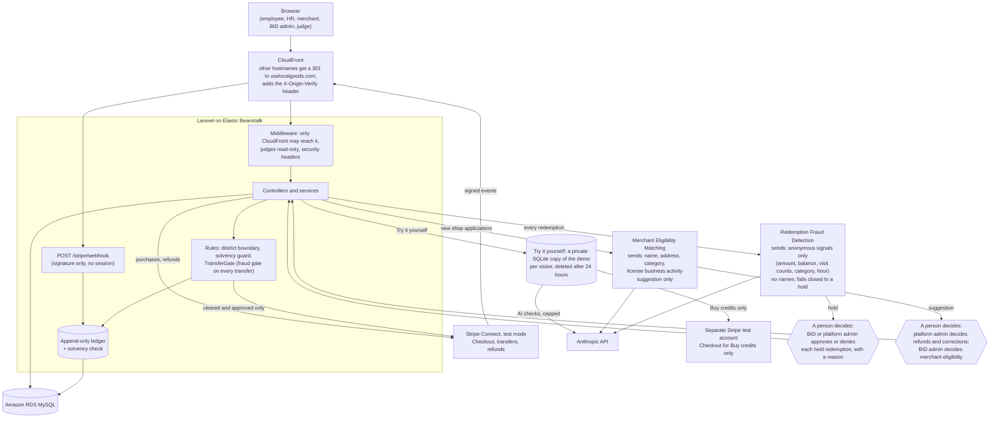

Reading it: a request reaches Laravel only through CloudFront. Money is
recorded on one append-only ledger, and the solvency check confirms the money
held covers every promise at the end of each money operation. A redemption is
scored first; a hold waits for a person. The transfer gate re-reads the row
and lets Stripe move money only for a cleared or approved redemption.
Merchant Eligibility Matching only suggests: its assessments for the committed
evaluation are stored in `data/merchant_assessments.json`, and a shop that
applies gets one suggestion for the BID admin to weigh. Everything runs in
Stripe test mode with no real money.

Try it yourself runs the same app against a private SQLite file for each visitor, with its own login, session and cache. The live Stripe keys are switched off inside it; its Buy credits uses a separate Stripe test account, and nothing it does reaches the live database or the live Stripe account. Its AI checks are capped per sandbox.

Main files:

- **Edge and middleware:** [`infra/cloudfront/canonical-host.js`](infra/cloudfront/canonical-host.js), [`bootstrap/app.php`](bootstrap/app.php), [`RequireCloudFrontOrigin`](app/Http/Middleware/RequireCloudFrontOrigin.php), [`TrustCloudFront`](app/Http/Middleware/TrustCloudFront.php), [`BlockJudgeWrites`](app/Http/Middleware/BlockJudgeWrites.php), [`SecurityHeaders`](app/Http/Middleware/SecurityHeaders.php), [`routes/web.php`](routes/web.php)
- **Redemption and fraud:** [`RedemptionService`](app/Services/RedemptionService.php), [`RedemptionFraudDetector`](app/Services/Fraud/RedemptionFraudDetector.php), [`SignalCalculator`](app/Services/Fraud/SignalCalculator.php), [`ClaudeClient`](app/Services/Ai/ClaudeClient.php), [`RedemptionReviewService`](app/Services/RedemptionReviewService.php), [`resources/prompts/`](resources/prompts/)
- **Eligibility:** [`MerchantEligibilityMatcher`](app/Services/Eligibility/MerchantEligibilityMatcher.php), [`MerchantApplications`](app/Services/Districts/MerchantApplications.php)
- **Ledger and solvency:** [`CreditLedger`](app/Services/CreditLedger.php), [`SolvencyGuard`](app/Services/Solvency/SolvencyGuard.php), [`SolvencyCheck`](app/Services/Solvency/SolvencyCheck.php)
- **Stripe:** [`StripeGateway`](app/Services/Payments/StripeGateway.php), [`TransferGate`](app/Services/Payments/TransferGate.php), [`MerchantPayouts`](app/Services/Payments/MerchantPayouts.php), [`StripeWebhookHandler`](app/Services/Payments/StripeWebhookHandler.php), [`routes/stripe.php`](routes/stripe.php), [`docs/STRIPE.md`](docs/STRIPE.md)
- **Corrections:** [`CorrectionDecisions`](app/Services/Corrections/CorrectionDecisions.php)
- **Sandboxes:** [`Sandbox`](app/Services/Sandbox/Sandbox.php), [`UseSandbox`](app/Http/Middleware/UseSandbox.php), [`SandboxRoutes`](app/Services/Sandbox/SandboxRoutes.php), [`SandboxStripe`](app/Services/Sandbox/SandboxStripe.php), [`SandboxIsolationTest`](tests/Feature/SandboxIsolationTest.php)

## Roadmap

Target dates, not promises. Nothing handles real money until the legal and security reviews are done.

| When (target) | What | Why it matters |
|---|---|---|
| Dec 2026 (after judging) | Enforce the Content-Security-Policy; update `laravel/tinker` and the other held framework updates; turn on Dependabot security updates; make passing CI a required check; add the refund cap at the ledger layer too; a full screen-reader pass | The free items marked "Still open" in [SECURITY.md](SECURITY.md); the updates were held back during the freeze. Accessibility so far: automated checks, a keyboard pass, and three fixes made from VoiceOver notes ([docs/accessibility.md](docs/accessibility.md)) |
| Q1 2027 | Employer self sign-up; ask one Business Improvement District to run a test pilot with fictional money; collect feedback from employers and merchants | Employers are set up by Local Goods today. A pilot shows what people actually do, not a projection |
| Q2 2027 | Legal and tax review (gift-card and unclaimed-property rules, payroll treatment); an independent security review; required two-step sign-in for real staff accounts; handling of card disputes and returned payments; a database guard against negative balances and real two-connection race tests on MySQL; and only then the steps needed before real money (Stripe live mode) | These are the "before real money" gaps in [SECURITY.md](SECURITY.md) and the legal questions in [Where the money is](#where-the-money-is) |
| Q3 2027 | A first real-money pilot in one district, if the reviews allow; decide on the merchant fee only after merchants see new sales; new fraud signals and web search for Merchant Eligibility Matching, each with a fresh unseen test set | The merchant fee stays at zero until merchants have seen new sales ([ADR 0029](docs/adr/0029-merchant-fee-ready-but-at-zero.md)). The planted collusion rings need new signals ([How the AI was measured](#how-the-ai-was-measured)) |
| Q4 2027 and beyond | A second district; a web application firewall and a second server (per-server rate limits and sandbox storage today); renew `security.txt` before 2027-11-10; paying for credits by bank transfer (ACH) once returned payments are handled; ideas with no date: residential property owners funding credits, a reusable wallet card (also in Apple Pay and Google Pay), delivery partners for Order to go (all three from Mike Maggitti's feedback), a mobile app, real email delivery and richer BID reports | A new district is a boundary plus its merchants ([ADR 0031](docs/adr/0031-districts-partnerships-merchant-joining.md)). The rest depends on scale or on partners, and a card needs Stripe Issuing approval, a regulated partner and legal advice ([ADR 0036](docs/adr/0036-no-card-preview-yet.md)) |

### Where it's going

The ideas with no dates, some drawn as sketches, are on the [Coming next page](https://uselocalgoods.com/coming-next). None of them is built, and no district or delivery service has agreed to take part.

### Get involved

Click **Request a demo** on [uselocalgoods.com](https://uselocalgoods.com), which opens your own email program. To report a security problem, use **Report a vulnerability** on this repository's Security tab ([SECURITY.md](SECURITY.md)).

---

Finn Butler · CUA Busch School AI Vibe Coding Contest, Fall 2026

Licensed under the [PolyForm Strict License 1.0.0](LICENSE): the source is public to read and for noncommercial use, but it is not open source.
